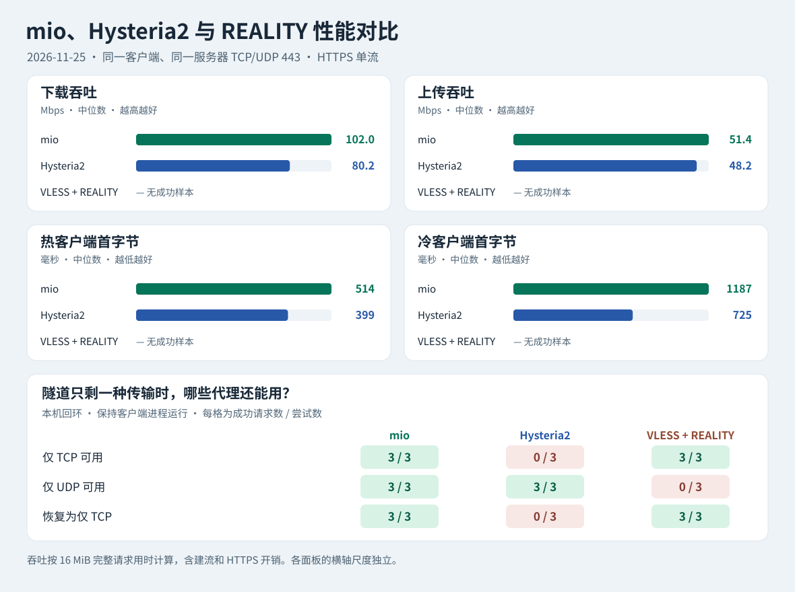

# mio代理协议

## 开始

欢迎来到该mio项目的文档页。

一个兼顾性能与抗审查的新型易用代理协议。

## 🚀 特性

- 抗审查: 使用utls来将数据包外观伪装成`Chrome`，并在认证失败时尽可能将数据转发给伪装网站。
- 抗重放攻击：内置`client/server_random`校验机制和后量子加密，有效抵抗重放攻击和量子计算机解密。
- 证书：像 Reality 一样借用 `dest` 站点，不用自己配置证书，而且完整进行一次真的TLS握手以欺骗审查设备。
- 认证：使用mio自己的`mio keygen`命令生成一对密钥来派生X25519MLKEM768证书，十分的安全。
- 选路：像Chrome那样先尝试TCP，然后UDP和TCP并发，并且谁快选谁。

mio的发布文件上一个和下一个版本几乎都是互不兼容的，所以请严格保持相同版本；更推荐一起滚动到最新版。

## 🏗️ 配置

使用`mio help`以获取命令行帮助，使用`mio keygen`生成服务端密钥对。

转到 [文档](https://github.com/orgmio/mio/tree/main/docs) 以获取详细说明。

## N 关于名称

之前他的仓库叫做ixa-go，名称是我随便想的。
后面更名为mio，因为我感觉ixa不太方便输入，
而m i o三个拉丁字母非常方便，并且也很符合他代理工具的特性。

因为m可以理解为machine（机器）
i可以理解为input（输入）
o可以理解为output（输出）

## ⚖️ 条款

此项目基于[Mo Public License](https://867678.xyz/docs/mopl)授权。

引用的其他项目使用他们自身的许可条款。

内置的QUIC-BBR来自Hysteria2，[许可条款](https://github.com/HyNetworks/hysteria/blob/master/core/LICENSE.md)

使用时需遵循您所在地区的法律和上述许可条款，

并，这是一个实验项目，作者不对任何后果承担责任，切勿用于非法用途。
