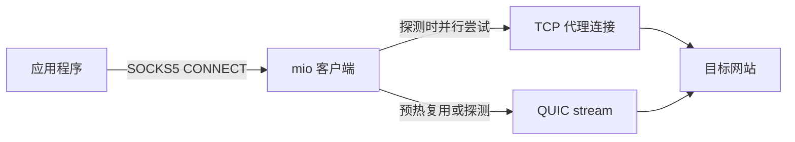

# mio怎么建立连接

这篇文档用简单的话说明：应用程序连到本地 SOCKS5 后，mio 怎么在 TCP 和 QUIC 之间选择，以及其中的数据怎么走。

## 先看一张图

探测时先成功的连接会交给应用，另一条随后关闭；应用数据不会复制或重发。

## 第一次连接

客户端启动后会在后台预热 QUIC 连接。应用程序通过本地 SOCKS5 发起 TCP `CONNECT` 时，如果预热已经成功，mio 会优先复用该连接；如果尚未选择传输方式，mio 会同时尝试两条路：

- **TCP 路**：连接 mio 服务端，经 uTLS 与伪装站握手；发送认证信息，服务端通过认证后接管连接；然后连接目标网站。
- **QUIC 路**：连接 mio 服务端的 UDP 端口，完成 QUIC 和 mio 会话认证；再通过一个 QUIC stream 请求服务端连接同一个目标网站。

并行探测时，哪条路先把代理连接建好、收到目标连接成功的应答，mio 就先把那条连接交给应用。另一条路即使后来成功，也会关闭。

应用的数据只通过交给应用的那一条连接发送，不会同时复制到 TCP 和 QUIC。探测期间，两条路可能各自让服务端尝试连接同一个目标；输家会很快关闭，因此目标端可能看到一次额外的短连接。

如果两条路都失败，这次请求返回连接错误，mio 暂时把 TCP 作为默认选择，之后再试。

## 后续连接

mio 记录 TCP 和 QUIC 建立代理连接所用的时间，并用平滑平均比较它们。简单说，新测量不会立刻完全覆盖旧结果：旧结果占大约四分之三，新结果占大约四分之一。两路都可用时，平均更快的那条会成为后续请求的优先线路。

如果优先线路发生传输层错误，mio 会尝试另一条线路；如果是目标明确拒绝连接，错误会直接返回，不会把它误当成线路故障。

mio 会在每次探测后随机等待约 10 到 30 分钟，再用新的目标请求比较一次。网络状况变了，优先线路也可以随之切换。

## 计时包括什么

这里测的不是单个 UDP 包或 TCP 包谁先到，而是**整个代理请求建立成功需要多久**：

- TCP 包含 TCP 建连、TLS 握手、认证、目标连接和成功应答。
- QUIC 包含 UDP/QUIC 建连、会话认证、stream 请求、目标连接和成功应答。

因此，测出来的是从应用请求到代理连接可用的整体速度，不是纯粹的网络 RTT。

## TLS 数据怎么处理

TCP 代理连接进入数据阶段后，mio 使用自己的 AEAD 保护所有数据，包括目标 TLS 的握手和应用数据。透明代理没有目标 TLS 会话密钥，无法验证 TLS 1.3 中加密的 Finished 消息是否有效，因此不能仅凭 record 外观确认握手完成，也不会自动切换到直传。实际的内层握手验证仍由应用程序和目标服务端完成。

前几个方向性数据 record 带有随机填充，由对端去除，不会转发给目标网站。这只能降低部分长度特征，不能保证完全消除 TLS-in-TLS 特征；持续使用外层加密也会增加处理和传输开销。

TCP 认证协议版本已更新，客户端和服务端需要同时升级；旧版和新版之间不能建立 TCP 代理连接。

## UDP 限制

mio 的 SOCKS5 只允许 TCP `CONNECT`，不提供应用 UDP 隧道，所以浏览器不能通过 SOCKS5 把 HTTP/3 的 UDP/443 流量塞进 mio。mio 客户端与服务端之间使用的 QUIC/UDP 是 mio 自己的传输连接，不是应用的 UDP 数据。

这项限制只约束经过本地 SOCKS5 的流量；它不会阻止设备上其他程序绕过 SOCKS5，直接向互联网发送 UDP/443。
